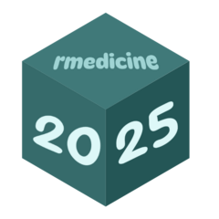

# Rmedicine2025

<!-- badges: start -->
<!-- badges: end -->

The goal of Rmedicine2025 is to ...

# Rmedicine2025 <a href="https://inkaa8.github.io/Rmedicine2025/"></a>


## Installation

You can install the development version of Rmedicine2025 like so:

``` r
# FILL THIS IN! HOW CAN PEOPLE INSTALL YOUR DEV PACKAGE?
```

## Example

This is a basic example which shows you how to solve a common problem:

``` r
library(Rmedicine2025)
## basic example code
```

